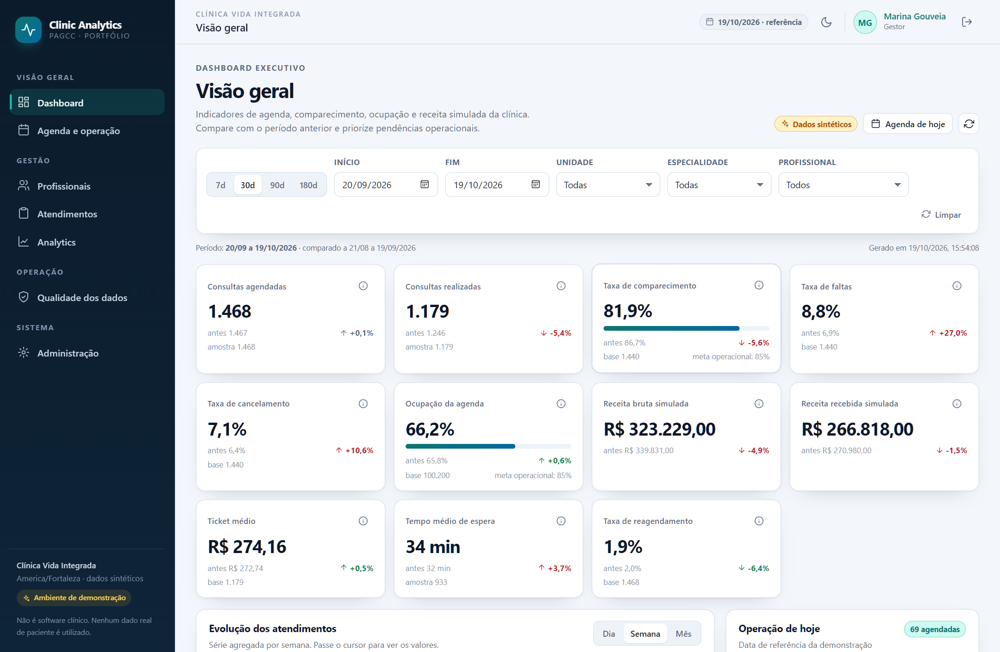
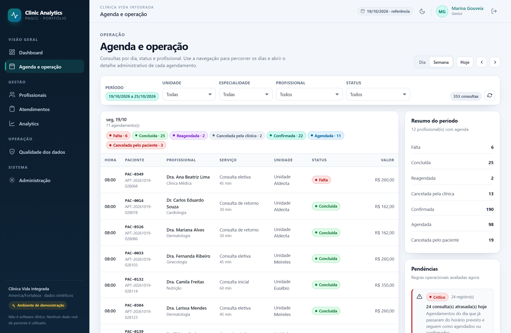
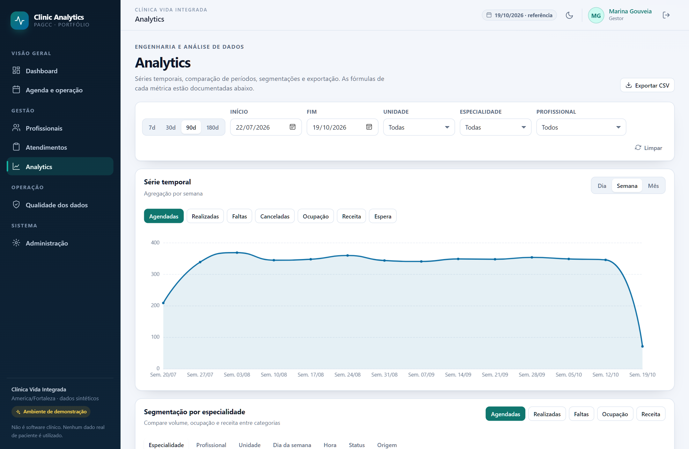
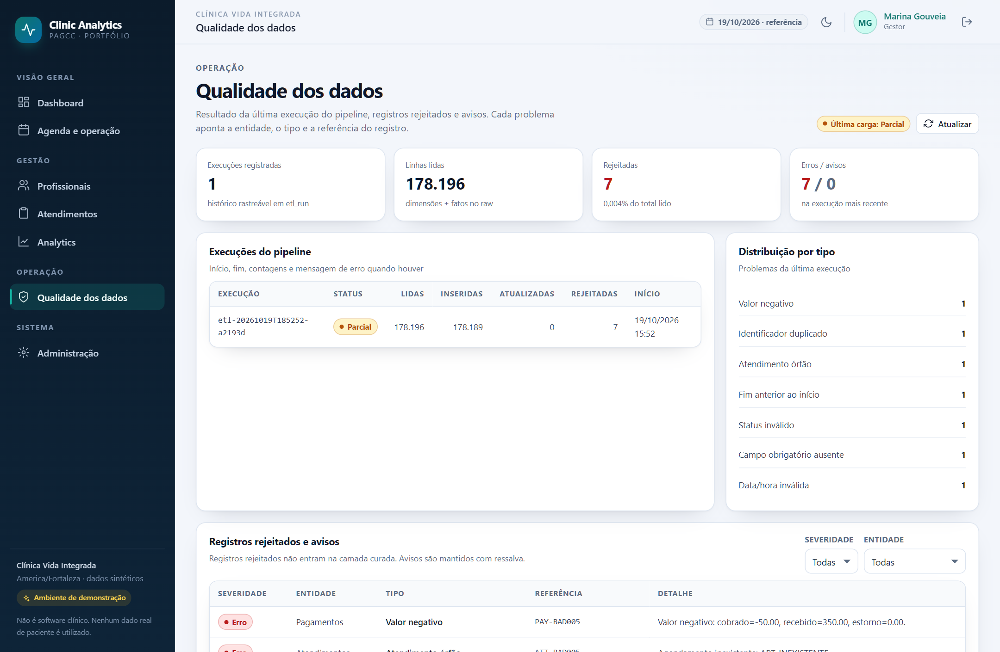
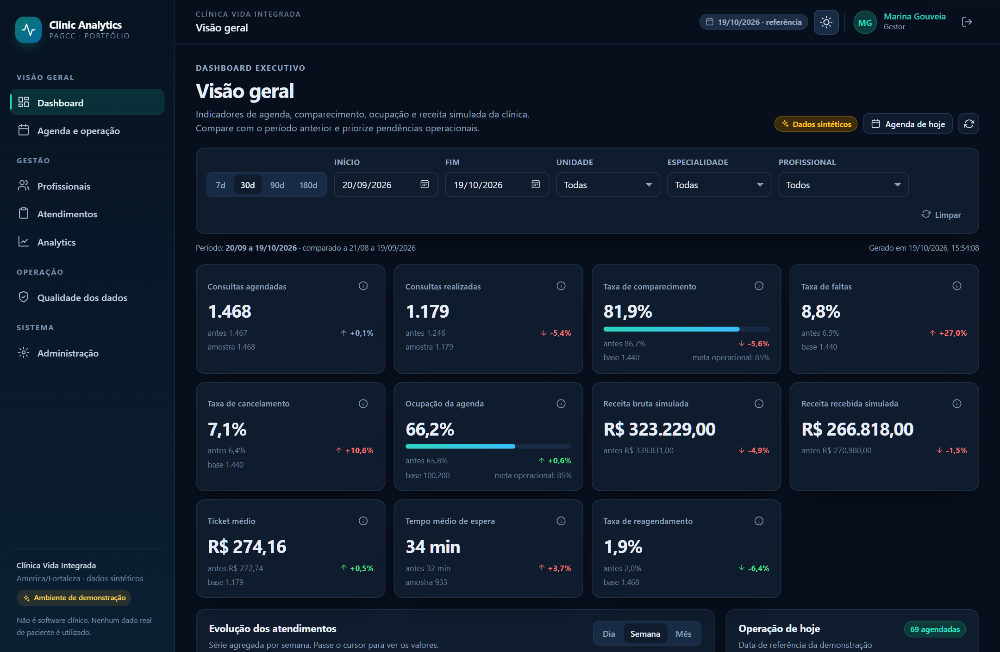

# Clinic Analytics — PAGCC

Plataforma analítica para gestão operacional e financeira de clínicas ambulatoriais
multiprofissionais. Projeto acadêmico/portfólio com dados **100% sintéticos**, construído de
ponta a ponta: geração de dados, ETL/ELT, banco relacional, API, dashboards e qualidade de dados.

> **Aviso:** este software é uma demonstração técnica. Não é prontuário eletrônico, não apoia
> decisão clínica e não deve ser usado com dados reais de pacientes.

Roteiro de apresentação: [docs/demo-script.md](docs/demo-script.md).



| Agenda e operação | Analytics |
| --- | --- |
|  |  |

| Qualidade dos dados | Tema escuro |
| --- | --- |
|  |  |

As imagens são capturadas da aplicação em execução por `npm run screenshots`
(ver [Captura de telas](#captura-de-telas)).

## Índice

- [O que o projeto demonstra](#o-que-o-projeto-demonstra)
- [Stack](#stack)
- [Arquitetura em uma página](#arquitetura-em-uma-página)
- [Execução rápida com Docker](#execução-rápida-com-docker)
- [Execução local (Windows)](#execução-local-windows)
- [Usuários de demonstração](#usuários-de-demonstração)
- [Pipeline de dados](#pipeline-de-dados)
- [Métricas do MVP](#métricas-do-mvp)
- [API](#api)
- [Testes e qualidade](#testes-e-qualidade)
- [Estrutura do repositório](#estrutura-do-repositório)
- [Decisões arquiteturais](#decisões-arquiteturais)
- [Limitações e segurança](#limitações-e-segurança)
- [Próximos passos](#próximos-passos)

## O que o projeto demonstra

- **Frontend** Vue 3 + TypeScript com tema claro/escuro, filtros combinados, gráficos,
  tabelas paginadas, estados de carregamento/erro/vazio e navegação por teclado.
- **Backend** FastAPI com autenticação JWT, autorização por papel, validação, paginação,
  ordenação, logs estruturados, erros padronizados e OpenAPI.
- **Dados** pipeline em camadas raw → staging → curada → analytics, com semente fixa,
  validações, rejeições rastreáveis, carga idempotente e reconstrução de agregados.
- **Operação** PostgreSQL, Alembic, Docker Compose com containers `pagcc-*`, CI e README
  reproduzível.
- **Domínio** agenda, atendimentos administrativos, profissionais, unidades, especialidades,
  valores simulados e qualidade de dados — sem conteúdo clínico.

## Stack

| Camada | Tecnologia |
| --- | --- |
| Frontend | Vue 3.5, TypeScript, Vite 7, Pinia, Vue Router, ECharts, Tailwind CSS 4 |
| Backend | Python 3.11+, FastAPI, Pydantic v2, SQLAlchemy 2, Alembic |
| Banco | PostgreSQL 16 (local: 18 também suportado) |
| Dados | Python, pandas/python-dateutil, JSONL/CSV, agregação diária |
| Testes | Pytest + httpx/TestClient · Vitest + Vue Test Utils |
| Qualidade | Ruff, ESLint, vue-tsc, GitHub Actions |
| Infra | Docker Compose, Nginx, healthchecks |

## Arquitetura em uma página

```text
┌──────────────────────────┐        ┌──────────────────────────────────────┐
│ Vue 3 + Vite (Nginx)     │  /api  │ FastAPI                              │
│ · dashboard executivo    ├───────►│ · JWT + RBAC                         │
│ · agenda / atendimentos  │        │ · serviços de métricas e agenda      │
│ · analytics / qualidade  │        │ · OpenAPI em /docs                   │
└──────────────────────────┘        └───────────────┬──────────────────────┘
                                                     │ SQLAlchemy
                                        ┌────────────▼─────────────┐
                                        │ PostgreSQL               │
                                        │ curado + analytics_daily │
                                        └────────────▲─────────────┘
                                                     │ carga idempotente
┌────────────────────────────────────────────────────┴──────────────────┐
│ Pipeline ETL/ELT (Python)                                             │
│ raw (JSONL) → staging (CSV) → curado (tabelas) → analytics (agregado) │
│ · validações e rejeições em data_quality_issue                        │
│ · execução registrada em etl_run (seed, âncora, contagens)            │
└───────────────────────────────────────────────────────────────────────┘
```

Detalhes em [docs/architecture.md](docs/architecture.md).

## Documentação

| Documento | Conteúdo |
| --- | --- |
| [Arquitetura](docs/architecture.md) | Componentes, fluxo de requisição e modelo analítico |
| [Métricas](docs/metrics.md) | Fórmulas, denominadores e regras de inclusão |
| [Dicionário de dados](docs/data-dictionary.md) | Tabelas, colunas, enums e regras de qualidade |
| [Glossário](docs/glossary.md) | Termos de domínio, status e papéis |
| [UX](docs/ux.md) | Princípios, identidade visual, estados e acessibilidade |
| [Roteiro de demo](docs/demo-script.md) | Apresentação guiada em ~10 minutos |
| [ADRs](docs/decisions/) | Decisões arquiteturais e trade-offs |

## Execução rápida com Docker

Pré-requisitos: Docker Desktop (ou Docker Engine + Compose) em execução.

```bash
cp .env.example .env        # ajuste JWT_SECRET se desejar
docker compose up --build
```

O Compose usa o projeto **`pagcc`** e cria containers com nomes explícitos:

| Container | Serviço | URL |
| --- | --- | --- |
| `pagcc-db` | PostgreSQL 16 | `localhost:5433` |
| `pagcc-backend` | FastAPI | http://localhost:8000 · docs em `/docs` |
| `pagcc-frontend` | Nginx + SPA | http://localhost:8080 |

Na primeira subida, o backend aguarda o banco, aplica migrações, cria os usuários de
demonstração e executa o pipeline (≈ 1–2 minutos). Acompanhe com:

```bash
docker compose logs -f backend
```

Comandos úteis:

```bash
docker compose ps
docker compose down            # mantém os volumes de dados
docker compose down -v         # apaga banco, raw e staging
docker compose exec backend python /app/data/quality/report.py
```

## Execução local (Windows)

Pré-requisitos: Python 3.11+, Node.js 22+, PostgreSQL 16+.

```powershell
# 1. Dependências
python -m venv .venv
.\.venv\Scripts\python -m pip install -r backend\requirements.txt
cd frontend; npm install; cd ..

# 2. Banco (exemplo com PostgreSQL local)
#    Crie o banco clinic_analytics e ajuste DATABASE_URL no .env
Copy-Item .env.example .env

# 3. Migrações + usuários + dados
cd backend
..\.venv\Scripts\python -m alembic upgrade head
..\.venv\Scripts\python -m app.cli.seed
cd ..
.\.venv\Scripts\python data\pipelines\run_pipeline.py --generate

# 4. API (terminal 1)
cd backend
..\.venv\Scripts\python -m uvicorn app.main:app --reload --port 8000

# 5. Frontend (terminal 2)
cd frontend
npm run dev
```

Acesse http://localhost:5173. O Vite faz proxy de `/api` para `http://127.0.0.1:8000`.

> No Linux/macOS, troque `.venv\Scripts\python` por `.venv/bin/python`.
> Para fixar a data de referência do conjunto, defina `ETL_ANCHOR_DATE=AAAA-MM-DD` no `.env`.

## Usuários de demonstração

Senha padrão: **`Clinic@2026`** (configurável por `DEMO_PASSWORD`).

| E-mail | Papel | Acesso |
| --- | --- | --- |
| `admin@clinicavida.example` | ADMIN | tudo + usuários |
| `gestor@clinicavida.example` | GESTOR | dashboards, exportação, status |
| `coordenador@clinicavida.example` | COORDENADOR | dashboards, exportação |
| `analista@clinicavida.example` | ANALISTA | analytics, exportação |
| `recepcao@clinicavida.example` | RECEPCAO | agenda e atendimentos |
| `profissional@clinicavida.example` | PROFISSIONAL | somente os próprios indicadores |

A autorização é aplicada no backend. O frontend apenas esconde ações não permitidas.

## Pipeline de dados

```bash
# gera raw para a âncora (semente padrão 42)
python data/generator/generate.py --seed 42 --anchor 2026-10-19

# valida, carrega e reconstrói a camada analytics
python data/pipelines/run_pipeline.py --generate

# relatório da última execução
python data/quality/report.py
```

- Camadas: `data/raw/<âncora>/*.jsonl`, `data/staging/<âncora>/*.csv`, tabelas curadas no
  PostgreSQL e `analytics_daily_metric`.
- Idempotência: upsert por chave natural (`external_id`/`code`). Reexecutar a mesma âncora
  resulta em `rows_inserted = 0` e `rows_updated > 0`, sem duplicar registros.
- Rejeições: o gerador injeta 7 casos inválidos por execução; todos aparecem em
  `data_quality_issue` e no dashboard de qualidade.
- Rastreabilidade: cada execução grava `etl_run` com seed, âncora, contagens e mensagem.
- A data de referência da demo (`demo_today`) é a âncora da última execução, garantindo que a
  agenda “de hoje” continue coerente mesmo dias depois da geração.

Detalhes em [data/README.md](data/README.md).

## Métricas do MVP

11 KPIs com fórmula, numerador, denominador e regras de inclusão documentadas em
[docs/metrics.md](docs/metrics.md):

1. Consultas agendadas
2. Consultas realizadas
3. Taxa de comparecimento
4. Taxa de faltas
5. Taxa de cancelamento
6. Ocupação da agenda
7. Receita bruta simulada
8. Receita recebida simulada
9. Ticket médio
10. Tempo médio de espera
11. Taxa de reagendamento

Além dos KPIs, o dashboard operacional gera tarefas priorizadas com **regra explícita**,
por exemplo: consultas atrasadas, confirmações pendentes em 48h, faltas recentes, ocupação
baixa por profissional, faixa horária com faltas acima da média e erros de qualidade.

## API

- Documentação interativa: http://localhost:8000/docs
- OpenAPI: http://localhost:8000/openapi.json
- Health check: `GET /health`

Principais endpoints:

```text
POST /api/v1/auth/login
GET  /api/v1/auth/me
GET  /api/v1/meta/options
GET  /api/v1/kpis/overview
GET  /api/v1/kpis/operational
GET  /api/v1/kpis/professionals
GET  /api/v1/kpis/timeseries
GET  /api/v1/analytics/breakdown?dimension=specialty|professional|unit|weekday|hour|status|source
GET  /api/v1/analytics/export.csv
GET  /api/v1/appointments?page=&page_size=&sort=&direction=
GET  /api/v1/appointments/agenda?start=&end=
GET  /api/v1/appointments/{id}
GET  /api/v1/attendances
GET  /api/v1/attendances/{id}
GET  /api/v1/professionals
GET  /api/v1/professionals/{id}
GET  /api/v1/quality/summary
GET  /api/v1/quality/issues
GET  /api/v1/quality/runs
GET  /api/v1/admin/status
GET  /api/v1/admin/users          (ADMIN)
POST /api/v1/admin/users          (ADMIN)
```

Erros seguem o formato:

```json
{ "error": { "code": "invalid_period", "message": "...", "details": null } }
```

## Testes e qualidade

```bash
# backend
cd backend
ruff check .
pytest

# frontend
cd frontend
npm run lint
npm run test
npm run build
```

Os testes de backend criam automaticamente o banco `<base>_test` e carregam uma amostra
sintética pequena (2 meses). Cobrem fórmulas, segurança, qualidade, idempotência do pipeline,
contratos da API, escopo por papel e exportação. O CI executa lint, testes, build e ida/volta
das migrações Alembic.

### Captura de telas

Com API (`:8000`) e frontend (`:5173`) em execução:

```bash
cd frontend
npm run screenshots
```

O script usa `playwright-core` com Edge/Chrome já instalado (ou `BROWSER_PATH`) e grava as
imagens em `docs/screenshots/`. Também falha se houver erro de console no navegador.

## Estrutura do repositório

```text
PAGCC/
├── backend/
│   ├── app/
│   │   ├── api/v1/        # rotas por domínio
│   │   ├── core/          # config, segurança, logs, erros
│   │   ├── db/            # engine, sessão, base
│   │   ├── models/        # SQLAlchemy + enums
│   │   ├── pipeline/      # gerador, validação, carga, analytics
│   │   ├── schemas/       # Pydantic
│   │   ├── services/      # regras de negócio e consultas
│   │   └── main.py
│   ├── alembic/           # migrações
│   ├── tests/
│   └── Dockerfile
├── frontend/
│   ├── src/
│   │   ├── api/           # cliente HTTP tipado
│   │   ├── components/    # UI reutilizável
│   │   ├── composables/
│   │   ├── layouts/
│   │   ├── router/
│   │   ├── stores/
│   │   ├── utils/
│   │   └── views/
│   ├── tests/
│   ├── nginx.conf
│   └── Dockerfile
├── data/                  # gerador, pipeline, qualidade e camadas
├── docs/                  # arquitetura, métricas, dicionário, ADRs, demo
├── database/              # aponta para as migrações Alembic
├── scripts/
├── docker-compose.yml
├── .env.example
└── README.md
```

## Decisões arquiteturais

| ADR | Decisão |
| --- | --- |
| [001](docs/decisions/001-stack.md) | Vue + FastAPI + PostgreSQL como stack principal |
| [002](docs/decisions/002-escopo-mvp.md) | Clínica médica ambulatorial, sem prontuário |
| [003](docs/decisions/003-camadas-e-analytics.md) | Camadas raw/staging/curado/analytics com agregado diário |
| [004](docs/decisions/004-autenticacao-rbac.md) | JWT + papéis + escopo de profissional no backend |
| [005](docs/decisions/005-dados-sinteticos.md) | Gerador determinístico e snapshot por âncora |
| [006](docs/decisions/006-observabilidade.md) | Logs JSON, request id e erros padronizados |

## Limitações e segurança

- Dados sintéticos; nenhum paciente real, CPF, telefone ou endereço.
- Sem prontuário, prescrição, diagnóstico ou qualquer conteúdo clínico.
- Receita simulada não representa caixa, faturamento de convênios ou emissão fiscal.
- Autenticação de demonstração: sem refresh token, recuperação de senha ou MFA.
- Ambiente local sem TLS; não expor publicamente sem revisar CORS, segredos, HTTPS e LGPD.
- Detecção de anomalias e sazonalidade são análises descritivas, não causalidade.
- O escopo vertical é clínica humana; veterinária/odontologia exigiriam modelo próprio.

## Próximos passos

- Refresh token, bloqueio por tentativas e auditoria de ações.
- Exportações assíncronas e cache de agregações para volumes maiores.
- Detecção de anomalias explicável (z-score/STL) com painel dedicado.
- Segunda vertical (veterinária) com modelo de animal/tutor separado.
- Deploy público com TLS, observabilidade e backups.

## Licença

MIT — uso livre para fins educacionais. Consulte [LICENSE](LICENSE).
